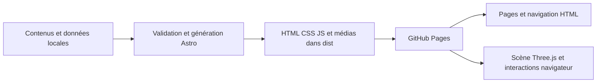

# Passation à l’agent codeur — portfolio d’Emeryc Chuttarsing

Date : 13 octobre 2026. Ce document est le point d’entrée pour la construction.
Il se suffit à lui-même pour comprendre la direction ; les études REA liées en
fin de document fournissent les détails techniques supplémentaires.

## 1. Mission et priorité

Construire un portfolio en anglais destiné à des recruteurs en finance
quantitative, machine learning et data science. Livrer une première version
complète, visuellement aboutie, fonctionnelle et prête à être publiée sur GitHub
Pages. Dépôt : `/Users/emeryc/Portfolio/emerycchuttarsing.github.io`.

**La priorité actuelle est le fonctionnement de bout en bout : pages, navigation,
scène 3D, données, médias, adaptation mobile, génération et publication.**
Les images et les textes définitifs seront retravaillés ensuite avec Emeryc.

Instruction explicite d’Emeryc : l’agent peut choisir les textes et les images
provisoires. Avancer avec des contenus de démonstration cohérents ; ne pas
attendre les visuels, les formulations, les chiffres ou les liens définitifs
pour construire l’ensemble. Prévoir leur remplacement simple et centralisé.

Cette liberté éditoriale ne change pas les sept projets ni leur hiérarchie.
Utiliser des données illustratives clairement identifiées lorsque nécessaire ;
les performances scientifiques réelles seront intégrées après vérification.

Le dépôt contient à ce stade les documents d’étude, pas une application déjà
construite. Inspecter son état et préserver les modifications existantes avant
l’initialisation. Utiliser une branche `codex/...` pour la construction.

## 2. Ce qui est confirmé, et ce que tu peux décider

### Invariants donnés par Emeryc

- Référence principale de l’accueil : [Ing Tian](https://ingtian.github.io/).
- Référence de créativité et de mise en scène des projets : [Studio Mirage](https://studiomirage.io/).
- Le paysage de points de l’accueil **accompagne l’apparition des panneaux de projets**.
- Montrer **tous les sept projets ensemble**, avec davantage de présence pour
  les trois projets phares. Éviter une galerie qui ne montre qu’un projet à la fois.
- Conserver une réelle profondeur et ambition visuelle dans la présentation 3D.
- Site en anglais ; identité finance quantitative + ML ; publication GitHub Pages.
- Les textes et visuels sont modifiables en aval et ne doivent pas bloquer le développement.

### Base d’exécution proposée

Les études avaient laissé ouverts le framework, la palette précise et le
placement exact. Pour démarrer concrètement, utiliser la base suivante :

- **Astro + TypeScript + Three.js**, génération statique et CSS avec variables.
- Accueil ivoire/encre ; galerie graphite avec accents lumineux maîtrisés.
- Composition ouverte sur grand écran : trois panneaux principaux et quatre
  secondaires, répartis en deux rangées.
- Titres, descriptions, liens et commandes en HTML ; paysage, panneaux et
  ambiance dans une scène 3D commune sur l’accueil.

Ces choix sont des décisions de travail pour l’implémentation, pas des détails
qu’Emeryc aurait déjà validés visuellement. Tu peux affiner les espacements,
polices, couleurs, poses de caméra et effets pour obtenir un ensemble convaincant.
Une modification technique substantielle doit être motivée dans la livraison ;
les ajustements courants ne nécessitent pas de nouvelle validation préalable.

## 3. Le mélange visuel recherché

| Partie | Ce que nous retenons | Adaptation attendue |
| --- | --- | --- |
| Premier écran | Composition d’Ing Tian : grand nom, élégance typographique, annotations discrètes, espace et terrain de points | Afficher Emeryc Chuttarsing et « Quantitative Finance & Machine Learning », avec accès aux projets et à la présentation |
| Passage aux projets | Continuité et mouvement de caméra de Mirage | Le terrain reste présent pendant que les sept panneaux apparaissent ; la transition forme une seule séquence |
| Galerie | Matières, relief, éclairage et aperçus animés de Mirage | Une vue ouverte des sept projets ; trois plus grands, quatre clairement lisibles |
| Sélection | Mise en avant et ambiance liées au média | Un panneau avance ou s’agrandit, révèle un résumé et permet d’ouvrir l’étude de cas |
| Pages projet | Lisibilité éditoriale et présentation des méthodes | Contenu structuré, figures, méthode, résultats ou exemples, limites et liens disponibles |

L’effet recherché est un portfolio scientifique élégant, avec une présentation
immersive des projets. La sophistication vient de la composition, des mouvements,
des matériaux et de la continuité. Les textes doivent rester faciles à lire.

Reproduire l’esprit et les mécanismes des références avec notre propre
implémentation. Créer des visuels provisoires adaptés aux projets : courbes,
trajectoires, nuages de points, surfaces, réseaux et schémas de modèles. Des
posters et boucles procédurales sont de bonnes premières ressources.
Les logos, films clients, polices et dunes propriétaires de Mirage ne sont pas
nécessaires à notre version.

### Point de départ typographique et chromatique

- Grand titre à empattements, éventuellement une partie en italique.
- Corps de texte sobre et annotations monospace ; trois rôles typographiques suffisent.
- Valeurs initiales possibles : papier `#F1EDE4`, encre `#201F1B`, graphite
  `#171D22`, texte clair `#F1EDE4`, accent ocre ou bleu désaturé.
- Commencer avec des polices système de qualité ; remplacer ensuite si utile.
- Centraliser couleurs, espacements, tailles et durées dans des tokens CSS.
- Garder les titres des projets lisibles au-dessus des effets et sous tous les états de lumière.

Ces valeurs sont des réglages initiaux à ajuster, pas une maquette figée.

## 4. Les sept projets à intégrer dès la première version

| Ordre | Projet / titre de travail | Présence | Idée de visuel provisoire |
| --- | --- | --- | --- |
| 1 | Reinforcement Learning & Path Signatures for Crypto Markets | Phare | Trajectoires de marché et représentation du chemin |
| 2 | Signature-Based Deep Hedging | Phare | Surface de couverture, chemins de prix ou distribution de pertes |
| 3 | Multi-Stage Music Recommendation | Phare | Graphe de recommandations et chaîne ALS → SASRec → MMR |
| 4 | Building a TinyStories Transformer | Secondaire visible | Tokens, attention et génération de texte |
| 5 | Optimization for Link Prediction | Secondaire visible | Graphe et apparition de liens |
| 6 | Visual Learning & Image Analysis | Secondaire visible | Tuiles d’images et carte de caractéristiques |
| 7 | Retail Demand Forecasting | Secondaire visible | Saisonnalité et segment de prévision |

Créer une page pour chacun, avec du contenu provisoire complet. Les quatre
secondaires peuvent avoir des études plus courtes ; leur accès doit fonctionner
comme celui des trois principaux. Ne pas attendre un résultat chiffré pour rendre
une page utile : problème, méthode, architecture et limites donnent déjà de la matière.

Emeryc indique avoir implémenté le code des projets. Le capstone est décrit dans
le CV comme une recherche en équipe : préserver ce contexte dans la formulation.
Les autres détails biographiques et les chiffres définitifs pourront être ajustés.

## 5. Pages et parcours

Créer les routes suivantes, avec ouverture directe et rechargement fonctionnels :

| Route | Contenu |
| --- | --- |
| `/` | Accueil, transition vers les sept projets, galerie, courte présentation, liens disponibles |
| `/projects/` | Index éditorial de tous les projets, immédiatement utilisable |
| `/projects/<slug>/` | Étude de cas du projet correspondant, selon un modèle partagé |
| `/about/` | Présentation, compétences, formation/expériences provisoires et liens disponibles |
| `/404.html` | Page d’erreur avec retour vers l’accueil et les projets |

Prévoir le CV téléchargeable et les liens de contact dans la navigation ou la
présentation. Si leur valeur réelle n’est pas disponible, laisser leur emplacement
configurable et ne pas afficher de faux lien actif. Cela ne bloque pas le reste du site.

Parcours principal : accueil → galerie complète → aperçu d’un projet → étude de
cas → retour à l’index ou à la galerie. Le visiteur peut aussi ouvrir une étude
directement depuis un lien HTML, sans devoir suivre la séquence 3D.

Le modèle de page projet comprend : titre et résumé, problème, contribution,
données/protocole, méthode/architecture, résultats ou illustration, limites,
puis liens disponibles. Les figures peuvent être provisoires et les sections
adaptées à la taille réelle du projet.

## 6. Comportement de la scène et des interactions

### Une scène commune à l’accueil

Porter le principe du terrain d’Ing Tian — une surface mathématique échantillonnée
en points — dans Three.js. Le relief de points et les panneaux partagent une
scène, une caméra et une profondeur. Le canvas n’est pas chargé de dessiner les
textes éditoriaux ni de fournir l’unique moyen de navigation.

Définir explicitement les états suivants :

| État | Comportement |
| --- | --- |
| `hero` | Grand nom lisible, paysage visible, mouvement d’ambiance discret |
| `reveal` | Apparition coordonnée des sept panneaux ; paysage toujours présent |
| `overview` | Les sept panneaux et leurs titres sont visibles et sélectionnables |
| `selected` | Projet mis en avant, résumé, accès à son étude, retour explicite à l’ensemble |
| `fallback` | Présentation HTML avec posters ; tous les projets restent accessibles |

Le défilement naturel pilote la progression vers la galerie. Il doit rester
possible de remonter et de rejoindre directement la section Projects. Ne pas
imposer une longue introduction, un drag ou une rotation pour atteindre un projet.

Un clic ou une commande clavier peut sélectionner le panneau ; une action
claire ouvre l’étude. Prévoir un bouton « Back to all projects » et Échap pour
quitter l’aperçu. Une sélection ne doit pas désorganiser les destinations des
liens, la navigation Retour du navigateur ou le défilement de la page.

### Composition et écrans étroits

À 1440 × 900, la vue de galerie doit cadrer les sept panneaux et leurs titres
ensemble : trois principaux plus grands et quatre secondaires en dessous.
La profondeur peut incliner ou décaler légèrement les panneaux ; elle ne doit
pas cacher les projets secondaires derrière les autres.

Sur une fenêtre plus courte, une tablette ou un téléphone, adapter la composition
au contenu : liste compacte de tous les titres et cartes dans le défilement
naturel. Un seul écran de téléphone n’a pas à contenir sept grands aperçus ;
aucun projet ne doit dépendre d’un carrousel ou d’un filtre pour être découvert.
Une navigation tactile doit fonctionner sans survol.

### Vidéos, lumière et effets

Chaque panneau possède un poster affichable immédiatement. Des boucles vidéo
ou animations peuvent enrichir les trois phares, puis les autres si le budget le
permet. Distinguer le nombre de panneaux visibles du nombre de vidéos en lecture.

Point de départ pour les essais : deux lectures simultanées sur ordinateur,
une sur mobile ou Safari ; priorité au projet sélectionné. La lecture reste
muette et inline. Un refus d’autoplay laisse le poster visible et l’interface
utilisable. Mettre en pause les médias hors champ ou lorsque l’onglet est masqué.

L’ambiance lumineuse peut suivre une couleur propre à chaque projet, puis une
courbe de couleurs synchronisée avec sa vidéo. Commencer avec des palettes
préparées ; il n’est pas nécessaire de calculer la couleur de chaque frame dans
le navigateur. Conserver l’intérêt visuel du terrain et des matières.

Un bloom discret peut contribuer au résultat. La distorsion de chaleur et le
fluide au pointeur sont des enrichissements optionnels, à ajouter après validation
de la composition et des performances. Ils ne doivent pas altérer les liens ou
la netteté des titres.

### Robustesse

- Respecter `prefers-reduced-motion` : présentation fixe ou transitions immédiates,
  sans lecture vidéo automatique ; toutes les pages et commandes restent disponibles.
- Afficher le contenu HTML et les posters avant que la 3D soit prête.
- En cas d’échec WebGL, de chargement d’un média ou de perte de contexte, revenir
  au rendu HTML des mêmes projets, en conservant leur ordre et leur contenu.
- Arrêter les boucles inutiles lorsque la scène est hors champ ou l’onglet masqué.
- Libérer géométries, textures, render targets, événements, observateurs et callbacks
  lors du démontage ; éviter les doubles boucles après navigation.
- Adapter le ratio de pixels et les effets aux performances sans supprimer de projets.
- Calculer les transitions à partir du temps écoulé, pour éviter un comportement
  qui change selon la fréquence de l’écran.

## 7. Architecture frontend, données et « backend »

### Socle proposé

**Astro en génération statique**, TypeScript pour les comportements et **Three.js
pour la scène**. Les pages et études de cas sont rendues en HTML à la construction.
Charger la scène côté navigateur, progressivement, sans empêcher la lecture du contenu.

Le moteur de scène doit être isolé des composants éditoriaux. Il reçoit la liste
des projets et une configuration ; il ne doit pas contenir les titres, médias,
liens et règles de contenu dispersés dans les shaders ou les animations.

Svelte/Threlte reste une alternative si cela simplifie réellement la réalisation.
Il n’est pas nécessaire de reprendre toute la stack de Mirage. Éviter d’introduire
plusieurs frameworks pour représenter les mêmes composants.

### Ce que signifie « front + back fonctionnels » ici

GitHub Pages sert des fichiers statiques ; il n’exécute pas de serveur Node ou
Python à chaque visite. Pour cette V1, la chaîne complète est donc :



La partie données et construction doit fonctionner réellement : validation du
contenu, génération de toutes les routes, résolution des médias, build reproductible,
configuration d’hébergement et vérification du site publié. Une base de données,
un CMS et une API ne sont pas requis pour ces fonctionnalités.

Si une démo Python/Streamlit, un formulaire avec envoi ou un calcul distant est
ajouté, utiliser un service externe adapté et tester son intégration. La V1 peut
présenter des données de démonstration locales et des vidéos à la place d’une
inférence distante. Ne pas connecter des boutons à une API fictive ou présenter
une simulation locale comme un appel réel à un serveur.

### Source unique des projets

Créer une collection structurée contenant au minimum : identifiant/slug, titre,
résumé, ordre, niveau de mise en avant, catégories, poster, vidéo optionnelle,
contenu de l’étude et liens optionnels. Les champs facultatifs absents sont
traités explicitement par les composants.

L’accueil, l’index, la scène et les routes des études lisent cette même collection.
Le nombre de panneaux, leur indexation et les tableaux de lumière en dérivent.
Ne pas reprendre les constantes « dix projets » de Mirage.

Séparer les données scientifiques éventuellement vérifiées des données illustratives.
Un contenu provisoire cohérent est accepté pour la première version fonctionnelle ;
il ne doit pas empêcher le build ou cacher les sept projets en production.

### Organisation cible indicative

```text
src/
  pages/                 accueil, index, routes projet, about, 404
  layouts/               structure commune et modèle d’étude de cas
  components/            navigation, hero, cartes, index, figures, commandes
  content/projects/      textes remplaçables des sept études
  data/                  métadonnées projets, identité et liens du site
  scene/                 initialisation, points, panneaux, caméra, médias, qualité
  styles/                tokens, mise en page, composants et responsive
public/
  media/                 posters, boucles et figures optimisés
  resume/                CV lorsque disponible
  favicon.svg
scripts/                 validation du contenu et de la sortie statique
tests/                   parcours critiques et logique sensible de la scène
.github/workflows/       vérifications et publication
```

Choisir une représentation claire pour relier textes et métadonnées, sans créer
plusieurs copies éditables des mêmes titres ou priorités.

L’accueil → galerie → sélection doit conserver sa scène. Les autres pages peuvent
utiliser une navigation HTML classique dans la V1. Si un routeur de transitions
est ajouté, gérer explicitement création/destruction ou persistance du canvas,
focus, historique et restauration du scroll.

## 8. Enseignements REA à exploiter

Les deux références ont été observées et leurs fichiers publics analysés.
Les graphes sont une aide pour vérifier des relations ; les réglages suivants
proviennent aussi de la lecture du code. Ils donnent des mécanismes à adapter,
pas des valeurs à copier systématiquement.

| Mécanisme compris | Conséquence pour notre implémentation |
| --- | --- |
| Ing Tian : terrain issu d’une somme de gaussiennes, dessiné dans un Canvas 2D | Porter le principe mathématique en points Three.js pour partager la profondeur avec les panneaux |
| Mirage : panneaux construits par code et géométrie partagée | Créer les sept panneaux à partir des données, sans modèle 3D complexe individuel |
| Mirage : poses de caméra reliées aux sections HTML | Nommer les états et centraliser la chorégraphie plutôt que disperser les seuils de scroll |
| Mirage : interpolation de pose et de fondu distinctes | Régler séparément la caméra, l’apparition des panneaux et les changements d’ambiance |
| Mirage : couleurs temporelles pré-calculées | Préparer les palettes ou courbes de couleurs avec les médias |
| Mirage : HTML coordonné avec des plans 3D | Garder des liens et commandes natifs, alignés avec la présentation visuelle |
| Mirage : ordonnanceur vidéo et nettoyage des ressources | Limiter les lectures et maîtriser le cycle de vie des textures |
| Mirage : résolution adaptative et réglages mobiles | Ajuster le coût graphique, avec une présentation complète des projets à tous les niveaux |

La première capture REA en exécution confirme un canvas, dix vidéos et les liens
des projets de Mirage pendant son chargement. Elle n’a pas mesuré la fluidité
ni validé toutes les interactions. Le graphe principal reste limité par le
plafond REA de 20 000 nœuds par fichier ; quatre extraits ciblés ont été analysés
sans troncature liée aux budgets. Il faut donc tester notre propre site.

## 9. Ordre de réalisation et critères de passage

1. **Fondations fonctionnelles.** Initialiser le projet, les données des sept projets,
   les routes et la mise en page HTML. Toutes les pages sont accessibles directement,
   avec du contenu provisoire et des médias de remplacement propres.
2. **Accueil et direction visuelle.** Approcher la composition d’Ing Tian, créer
   le terrain et définir la typographie, la palette et les espacements.
3. **Scène de galerie.** Coordonner terrain, apparition des sept panneaux, vue
   d’ensemble et sélection. Vérifier le cadrage avant d’accumuler les effets.
4. **Finition et adaptation.** Ajouter matières, éclairage, médias et transitions ;
   régler mobile, clavier, mouvement réduit et gestion des ressources.
5. **Recette et livraison.** Tester le build, les parcours, les liens, les modes
   dégradés et l’hébergement ; documenter les commandes et contenus à remplacer.

Ces étapes organisent la réalisation de la V1. Elles ne sont pas des invitations
à s’arrêter après une maquette ou à attendre le contenu définitif. Poursuivre
jusqu’à un ensemble fonctionnel, en signalant seulement les blocages réels.

## 10. Déploiement prévu

Cible : `https://emerycchuttarsing.github.io/`, dépôt
`emerycchuttarsing/emerycchuttarsing.github.io`.

- Configurer `site` avec cette URL et une base `/` : c’est un dépôt de site
  utilisateur, pas un site sous `/nom-du-projet/`.
- Générer les routes des études au build ; vérifier ouverture directe et rafraîchissement.
- Définir des versions compatibles des dépendances, conserver le lockfile et
  utiliser `npm ci` dans les vérifications automatisées. Node 24 est la base proposée.
- Préparer une CI qui vérifie les types, le contenu, le build et les parcours critiques.
- Préparer un workflow GitHub Pages avec jobs de construction et de publication,
  environnement `github-pages` et permissions adaptées au déploiement.
- Publier uniquement le dossier généré `dist/`. Les études REA, chemins locaux,
  jeux de données, checkpoints et fichiers de travail ne sont pas des assets du site.
- Garder les éventuelles clés de services dans leur environnement serveur ;
  aucune fonctionnalité de cette V1 ne nécessite une clé secrète dans le navigateur.

Le présent transfert prépare la construction et le déploiement ; aucune publication
n’a déjà été effectuée dans ce chat. Lorsque l’exécution du déploiement est autorisée
et l’accès GitHub disponible, aller jusqu’à la vérification de l’URL publique.
Si seul le build local a été validé, le dire explicitement dans la livraison.

Rendre le retour arrière praticable : noter le commit publié et conserver un
historique permettant de reconstruire une version précédente fonctionnelle.

Documentation officielle de référence : [Astro sur GitHub Pages](https://docs.astro.build/en/guides/deploy/github/),
[workflows GitHub Pages](https://docs.github.com/en/pages/getting-started-with-github-pages/using-custom-workflows-with-github-pages),
[collections de contenu Astro](https://docs.astro.build/en/guides/content-collections/).
Revérifier les versions des actions au moment de créer les workflows.

## 11. Recette : ce que « fonctionne » doit vouloir dire

Ne pas promettre un fonctionnement parfait sans vérification. Livrer les preuves
correspondant aux contrôles réellement effectués et préciser les appareils non testés.

- [ ] Installation reproductible, vérification des types et build de production réussis.
- [ ] Accueil, index, sept études, About et 404 présents dans la sortie statique.
- [ ] Ouverture directe, rechargement, navigation Retour et liens internes fonctionnels.
- [ ] À 1440 × 900, les sept panneaux et leurs titres sont visibles ensemble dans
  l’état galerie ; les trois phares se distinguent sans masquer les quatre autres.
- [ ] À 390 × 844 et en largeur réduite, tous les projets sont accessibles dans
  une mise en page lisible, sans débordement horizontal ni geste de survol requis.
- [ ] Sélection, fermeture, ouverture de l’étude et retour fonctionnent à la souris,
  au tactile et au clavier ; focus visible et ordre de tabulation compréhensible.
- [ ] Mouvement réduit, absence de WebGL, échec d’une vidéo et autoplay refusé
  conservent une interface utilisable avec les mêmes projets.
- [ ] Pas d’erreur bloquante ni de ressource interne introuvable dans les parcours testés.
- [ ] Les médias en pause ou hors champ ne continuent pas à mobiliser inutilement
  le rendu ; plusieurs navigations n’accumulent pas canvases ou boucles d’animation.
- [ ] Vérification sur Chromium et WebKit/Safari lorsque disponibles ; distinguer
  l’émulation d’un essai sur appareil physique.
- [ ] Mesurer le chargement et la fluidité sur des configurations décrites. Viser
  60 images/s sur ordinateur et une expérience stable sur mobile, sans annoncer
  ces cibles comme des performances acquises avant mesure.
- [ ] Titres de pages, descriptions, favicon et aperçu de partage cohérents.
- [ ] Chaque contrôle actif a une fonction réelle ; les liens définitifs manquants
  sont omis ou présentés clairement comme indisponibles.
- [ ] Si déployé : vérifier l’accueil, une route profonde, les médias et le CV
  disponible à l’URL publique, puis consigner le commit et le résultat.

Les essais doivent couvrir les vrais risques du site : navigation, cadrage,
cycle de vie de la scène et solutions de repli. L’existence de tests ne remplace
pas une inspection visuelle de l’accueil, de la galerie et d’une étude de cas.

## 12. Livraison attendue et reprise des contenus

Livrer le code, les configurations, les médias provisoires nécessaires, la procédure
locale et le workflow de publication. Le README doit expliquer comment lancer,
vérifier, construire et publier le site, ainsi que les limites encore connues.

Ajouter une courte carte de remplacement des contenus indiquant où modifier :
nom/biographie, textes des projets, posters, vidéos, figures, CV, liens, palette,
positions des panneaux et paramètres de mouvement. Fournir les chemins exacts.
Aucun remplacement éditorial courant ne doit demander de comprendre un shader.

Dans le compte rendu final, préciser : ce qui fonctionne, les tests et observations
réalisés, l’URL locale ou publique disponible, les contenus encore provisoires
et les éventuels points techniques restants. Ne pas confondre une V1 fonctionnelle
avec une validation scientifique définitive des études de cas.

## Annexes du dépôt, si un détail est nécessaire

- [Synthèse du mélange Ing Tian × Mirage](DESIGN_SYNTHESIS_ING_MIRAGE.md).
- [Brief et positionnement](BRIEF.md).
- [Ing Tian : accueil et paysage mathématique](references/ING_TIAN.md).
- [Mirage : mécanismes 3D, caméra, vidéos et lumière](references/STUDIO_MIRAGE_3D.md).
- [Dernière analyse REA : résultats, limites et provenance](references/STUDIO_MIRAGE_REA_DEEP.md).
- [Preuves REA sélectionnées](references/evidence/MIRAGE_REA_DEEP_EVIDENCE.json).

Ces annexes documentent l’historique. Le présent document intègre la dernière
instruction d’Emeryc : laisser l’agent avancer avec des images et textes provisoires
et concentrer l’exécution sur un site complet et fonctionnel.
