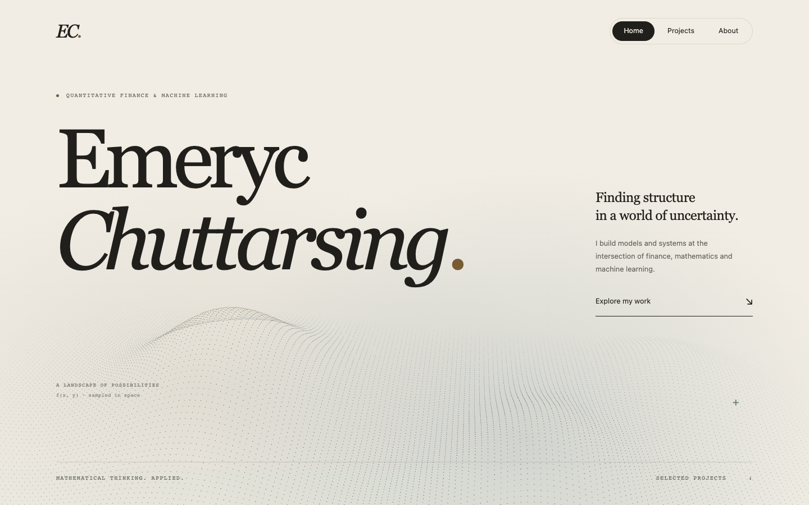
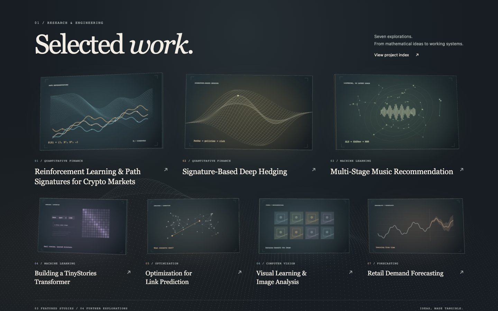
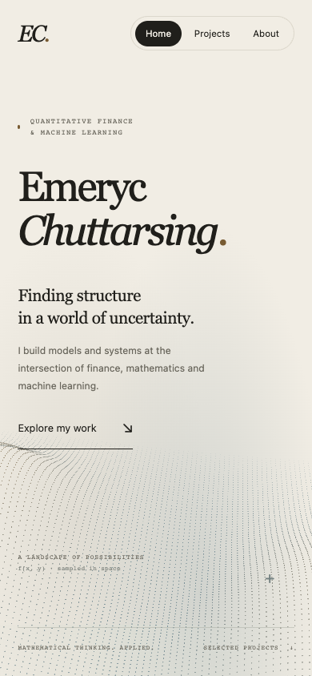
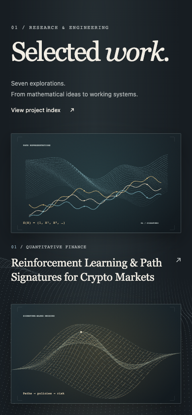
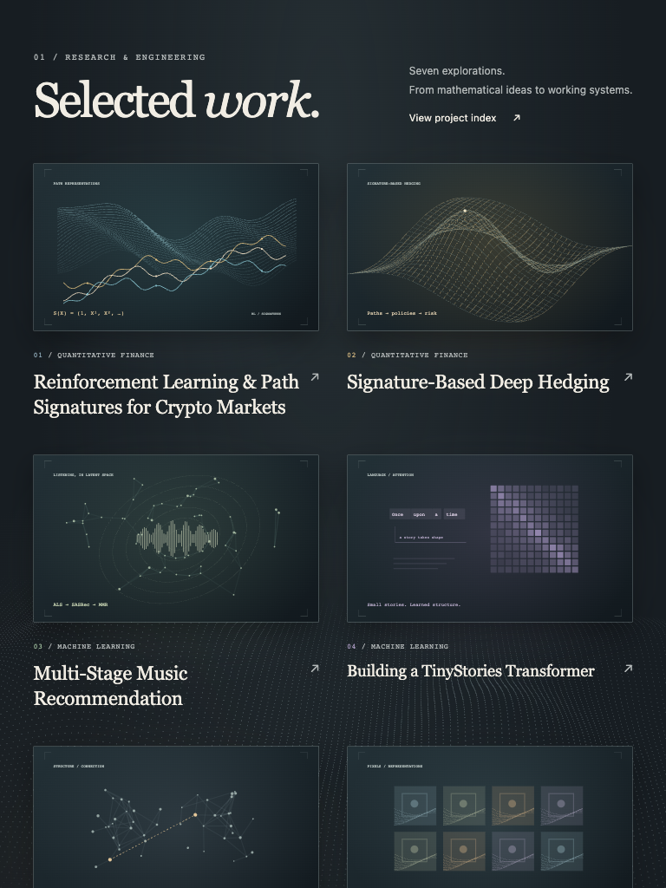
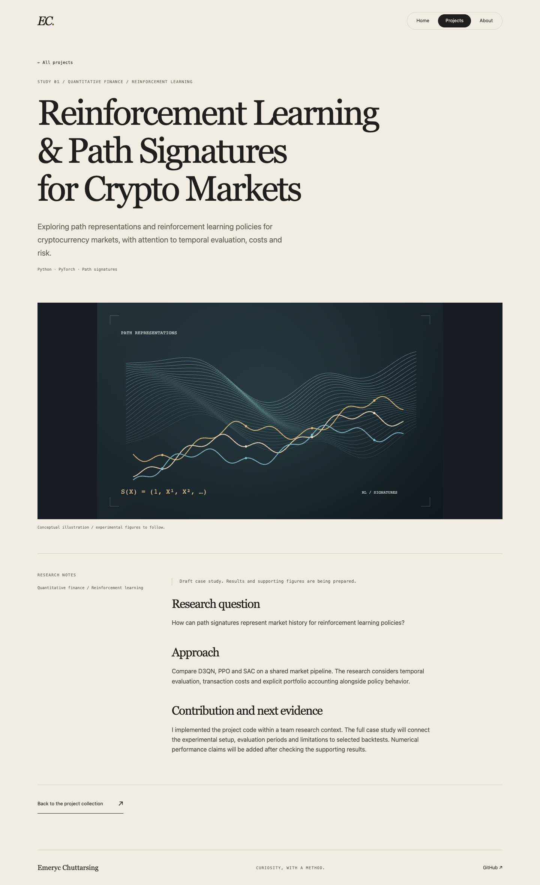
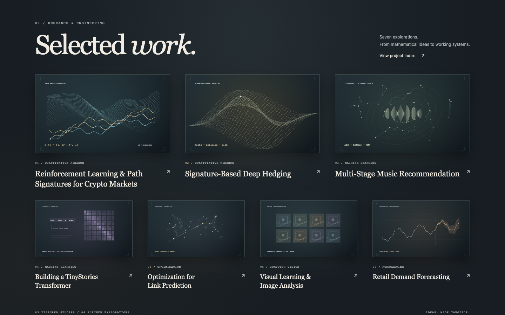

# Recette du jalon 2

Vérification locale le 13 octobre 2026 (Los Angeles), soit le 14 octobre en UTC.
Chrome **155.0.8059.79**, Mac local, mode headless, DPR 1. Le navigateur intégré
Codex a également été actualisé et inspecté en largeur compacte.

## Composition retenue

L’accueil reprend d’Ing Tian la composition typographique ample, la sérif en
italique, les annotations monospace, les espaces ouverts et le paysage de points.
La galerie reprend de l’étude Mirage les panneaux réellement épais, les
inclinaisons, la lumière et la profondeur dans une scène commune. L’organisation
reste propre au portfolio : trois panneaux phares, quatre secondaires, tous
accessibles simultanément. Les médias sont sept illustrations originales.

L’ivoire domine l’accueil et les pages de lecture. Le graphite domine la galerie,
avec des accents ocre, bleu grisé, vert et violet désaturés. Une bande de brume
fait le passage entre ces ambiances. Le terrain demeure derrière la galerie.
Deux poses fixes suffisent à cette étape ; la continuité animée viendra au jalon 4.

## Résultats

| Contrôle                                            | Résultat                                                                                  |
| --------------------------------------------------- | ----------------------------------------------------------------------------------------- |
| Formatage, Astro Check, build, liens                | Réussite ; 25 fichiers sans diagnostic Astro ; 11 pages, 152 références internes          |
| 1440 × 900                                          | Sept panneaux/titres dans le même écran ; contenu des cartes entre y = 211,5 et 827,8 px  |
| 1280 × 800                                          | Sept panneaux/titres visibles ; dernier titre avant y = 788,3 px                          |
| 768 × 1024                                          | Galerie HTML sur deux colonnes, sept liens conservés                                      |
| 390 × 844                                           | Galerie HTML sur une colonne ; aucun débordement horizontal                               |
| Index, étude, About, 404 à 390 px                   | Aucun débordement horizontal                                                              |
| Clavier                                             | Lien d’évitement et sept liens projet atteignables, focus visible                         |
| Navigation                                          | Sept études ouvertes, rechargées et retour vers la galerie réussi                         |
| Hors accueil                                        | Aucun canvas dans l’index, les études, About ou la 404                                    |
| Sans JavaScript                                     | Sept posters chargés, sept destinations HTML disponibles                                  |
| Mouvement réduit                                    | Renderer non chargé, zéro canvas ; images conservées                                      |
| WebGL indisponible / contexte perdu                 | Images rétablies, liens conservés                                                         |
| Préférence de mouvement modifiée en cours de visite | Démontage/remontage sans double canvas                                                    |
| Redimensionnement hors champ puis retour            | Canvas correctement dimensionné et panneaux réalignés                                     |
| Rendus au repos                                     | Zéro nouvelle demande de frame pendant l’échantillon de 500 ms                            |
| Navigations répétées                                | Un seul canvas à chaque retour sur l’accueil                                              |
| Console                                             | Aucune erreur inattendue ; erreur Three attendue lors de la simulation WebGL indisponible |

Les détails mesurés figurent dans [report.json](report.json).
Le script reproductible est [check-browser.mjs](../../../scripts/check-browser.mjs).
Les captures ci-dessous correspondent au build validé, avant commit.

## Captures

### Accueil — 1440 × 900

### Galerie — 1440 × 900

### Accueil et galerie compacts — 390 × 844

### Galerie — 768 × 1024

### Gabarit d’étude

### Repli sans JavaScript

## Limites et suites

- Émulation des dimensions dans Chrome ; aucun essai sur téléphone physique.
  WebKit n’est pas installé dans l’outillage local ; Safari reste à vérifier.
- Vite émet un avertissement de taille pour le module Three.js : **545 443 octets
  minifiés, 135 835 octets gzip**. Il est importé uniquement sur l’accueil et
  jamais en mouvement réduit. Le petit module d’amorçage fait 2 375 octets.
  L’optimisation de chargement et les mesures sur appareils font partie de la
  recette finale. Ce jalon ne revendique pas une cadence de 60 images/s mesurée.
- Les posters sont des illustrations conceptuelles ; les résultats scientifiques
  et les textes définitifs restent à compléter au jalon 3.
- La caméra change de pose sans interpolation ; sélection, vidéos, transitions
  et interactions avancées sont réservées au jalon 4.
- Les réglages compacts rendent déjà le site utilisable. La finition responsive
  complète est prévue au jalon 5.
- Validation et commit locaux uniquement ; aucun déploiement public.
