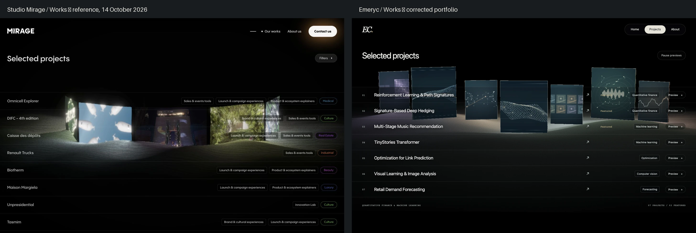

# Reprise du jalon 2 — validation Mirage Works

Recette du 14 octobre 2026. Base : `937bbb3`, branche `codex/portfolio`.
Dossier assemblé : 2026-10-14T14:14:44-07:00. La comparaison porte sur la composition Works demandée
par les nouveaux documents. La publication publique reste à effectuer lors de la livraison finale.

## Résultat et comparaison visuelle



Référence : [Studio Mirage — Works](https://studiomirage.io/works), observée dans
le navigateur intégré le 14 octobre, état stabilisé à 1440 × 900. Capture du
portfolio au même viewport, index ouvert directement et sans survol préalable.

| Aspect               | Observation de la correction                                                                                                                        |
| -------------------- | --------------------------------------------------------------------------------------------------------------------------------------------------- |
| Composition          | Liste fine devant le décor ; ancienne grille retirée sur les deux entrées.                                                                          |
| Fond et typographie  | Noir profond, titre sans empattements à 35 px environ, marges de 43 px à 1440. Le hero conserve Georgia et l’ivoire.                                |
| Cadrage              | Sept lignes de y=288 à 750 à 1440 × 900 ; de y=254 à 674 à 1280 × 800. Sept panneaux dans le cadre.                                                 |
| Profondeur           | Poses propres dans un arc ouvert, rotations, écart de profondeur, cadres épais et trois phares plus grands.                                         |
| Relief et matière    | Surface continue issue du paysage mathématique, normales, grain, volumes au premier plan et sept contributions lumineuses.                          |
| Lumière              | Halos colorés localisés ; couleurs interpolées des médias ; bloom discret, vignettage et fond maintenu noir.                                        |
| Adaptations visibles | Les sept identités restent exposées ensemble ; les illustrations scientifiques et la géométrie mathématique diffèrent des films et dunes de Mirage. |

La nouvelle composition se rapproche nettement de Works. Les médias conceptuels
ont une palette plus sobre et le relief garde une forme mathématique. Cette
comparaison valide les éléments de composition demandés ; elle ne constitue pas
une promesse de reproduction pixel à pixel des films, polices ou modèles du studio.

## Tableau de recette V1–V8

| ID  | Statut                               | Preuve / contrôle                                                                                                                                                                                          |
| --- | ------------------------------------ | ---------------------------------------------------------------------------------------------------------------------------------------------------------------------------------------------------------- |
| V1  | Vérifié                              | [Index 1440](index-1440x900.png), fond noir, titre sans empattements et liste devant le décor.                                                                                                             |
| V2  | Vérifié                              | [1440](index-1440x900.png), [1280](index-1280x800.png), sept lignes et sept faces projetées ; largeur minimale 114.3 px, exposition conservatrice minimale 100.0 %.                                        |
| V3  | Vérifié                              | Trois mentions Featured, trois panneaux plus grands ; les quatre secondaires restent visibles.                                                                                                             |
| V4  | Vérifié visuellement et dans le code | [Comparaison](comparison.webp), positions mondiales indépendantes des lignes, sol maillé, halos, bloom/vignette.                                                                                           |
| V5  | Vérifié                              | [Hero](hero-1440x900.png), [transition](reveal-1440x900.png), [Works sur l’accueil](gallery-1440x900.png), entrée directe sur l’index. Transition inversée testée.                                         |
| V6  | Vérifié                              | [Phare actif](active-featured.png), [secondaire actif](active-secondary.png), focus prioritaire, temporisation média 120 ms, historique inchangé au survol, [aperçu explicite](selected-1440x900.png).     |
| V7  | Vérifié aux dimensions prévues       | [Tablette](index-768x1024.png), [téléphone complet](index-390x844.png), liste naturelle, absence de débordement ; reflow simulé à 720 × 450 avec DPR 2.                                                    |
| V8  | Vérifié                              | [Sans JS](index-no-js.png), [sans WebGL](index-no-webgl.png), [mouvement réduit](index-reduced-motion.png), [perte de contexte](index-context-loss.png), [erreur vidéo](video-error.png), liens conservés. |

## Contrôles réellement exécutés

Depuis le dépôt, avec Chrome installé et le module Playwright fourni par l’environnement :

```sh
npm run verify
PLAYWRIGHT_MODULE=/Users/emeryc/.cache/codex-runtimes/codex-primary-runtime/dependencies/node/node_modules/playwright/index.mjs node scripts/check-interactions-browser.mjs
PLAYWRIGHT_MODULE=/Users/emeryc/.cache/codex-runtimes/codex-primary-runtime/dependencies/node/node_modules/playwright/index.mjs PORTFOLIO_SCREENSHOTS=test-results/mirage-regression-layout node scripts/check-browser.mjs
PLAYWRIGHT_MODULE=/Users/emeryc/.cache/codex-runtimes/codex-primary-runtime/dependencies/node/node_modules/playwright/index.mjs PORTFOLIO_SCREENSHOTS=test-results/mirage-regression-content node scripts/check-content-browser.mjs
```

- `npm run verify` : formatage, 48 fichiers Astro/TypeScript sans diagnostic,
  build statique réussi, **11 routes et 222 références internes**.
- Recette Works : **34 scénarios**, **8 contrôles de mise en page**
  (deux entrées × quatre dimensions), aucune exception JavaScript.
- Parcours : sept études, liens directs, previews, Tab/Shift+Tab, Échap, restauration
  du focus et du scroll, Retour/Avancer, rechargement et retour depuis une étude.
- Vidéos : au maximum deux lecteurs desktop, un en configuration contrainte ;
  priorité du projet actif, pause hors champ et en onglet masqué, reprise manuelle
  après refus d’autoplay, échec média, Save-Data et mouvement réduit.
- Une correction issue des tests lie la lecture aux **panneaux projetés visibles** :
  une portion de liste encore visible ne suffit plus à maintenir les vidéos.
- Un canvas sur accueil/index, aucun dans les études/About. Pas d’accumulation après
  neuf cycles d’aperçu : **5 géométries / 24 textures** après initialisation,
  identiques aux trois relevés (cibles de post-traitement incluses).
- Corps Markdown des sept études comparés au commit de départ : identiques.
  CV identique, SHA-256 `f631314864111a11db84a022e44a49d282e00e0002cfa17fc65a142152a239ba`.
- Ancienne recette de contenu : neuf pages à quatre dimensions, sommaires,
  navigation précédente/suivante, lecture sans JavaScript, CV et e-mail.

Les [résultats Works](report.json), [contrôles de mise en page](layout-regression.json)
et [contrôles éditoriaux](content-regression.json) conservent les mesures.

### Fluidité et limites de mesure

Chrome **155.0.8059.79**, macOS, GPU déclaré : `ANGLE (Apple, ANGLE Metal Renderer: Apple M3, Unspecified Version)`.
Sur 144 intervalles `requestAnimationFrame` pendant dix changements de projet actif :
**60.0 Hz en moyenne**, médiane **16.7 ms**, p95 **16.8 ms**.
Il s’agit de la cadence navigateur pendant les transitions, pas d’un chronométrage
GPU de chaque passe. Les vidéos sont encodées à 24 images/s. Scène et médias en pause :
aucun RAF supplémentaire une fois les transitions stabilisées.

## Fichiers et remplacement des contenus

Voir [la liste des fichiers changés](files-changed.txt).

- Présentation : `ProjectsShowcase.astro`, `ProjectRows.astro`, les deux routes,
  thème du layout, `works.css` ; hero et styles éditoriaux conservés.
- Scène : `layout`, `height`, `ground`, `lighting`, `postprocessing`, renderer et
  configuration. `mount` injecte les références et le mode home/index.
- Interaction : `highlight`, ordonnanceur vidéo, adaptation de `selection` et du
  dialogue. L’ancienne grille et ses styles sont retirés.
- Contenu : `displayTitle` facultatif, `scenePoster` sans légendes coupées ; les
  titres complets et figures des études sont conservés. Trois MP4 conceptuels
  sans texte embarqué, courbes de couleurs et trois décors statiques WebP locaux.
- Outillage : tests adaptés, génération des faces/couleurs et capture des replis ;
  architecture et documentation actualisées. Aucune nouvelle dépendance npm.

Les remplacements sont expliqués dans [MEDIA.md](../../MEDIA.md) et
[la documentation de scène](../../../src/scene/README.md).

## Non vérifié / suite du jalon 5

- Safari et Firefox réels, téléphones physiques et zoom natif de navigateur :
  non testés. Les profils Safari/mobile et le reflow à DPR 2 sont simulés sous Chrome.
- Les performances ci-dessus concernent ce Mac, sans garantie pour tout GPU.
- Vite signale toujours un chunk Three.js/effets supérieur à 500 kB ; son chargement
  reste dynamique sur les deux pages de scène. L’optimisation finale appartient au jalon 5.
- Filtres, distorsion de chaleur et fluide au pointeur sont différés selon le brief.
- Textes et illustrations restent provisoires ; aucune publication ou push n’a été effectué.
