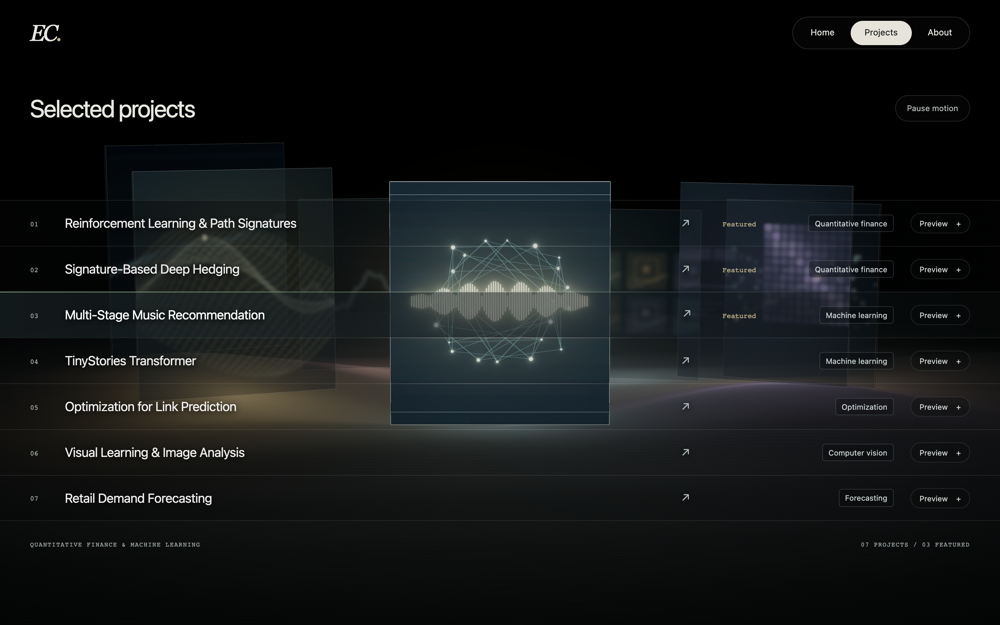

# Orbital gallery prototype

14 October 2026. Extends the Retina correction `e679b47`, following the request
for a larger, slowly rotating and softly focused background.

## Design behavior

- The seven panels share an elliptical 3D orbit. Featured faces are about 47%
  taller than before, secondary faces about 58% taller. Depth overlap is intentional.
- Ambient motion is one revolution every **90 seconds** (4 degrees/second).
- Hover or keyboard focus takes the shortest arc to bring the corresponding
  panel to the front. A damped spring preserves velocity during retargeting and
  slows to rest. Image, frame and ground light become more prominent.
- All drifting image faces are softly filtered; the active face and the explicit
  preview remain sharp. The HTML, frames and ground retain their Retina rendering.
- Leaving the list resumes the slow drift. Focus has priority over pointer hover.
- Pause motion freezes both the orbit and the videos, and displays sharp stills.
  Reduced motion, Save-Data and hidden tabs stop ambient motion. The orbit and
  videos also stop when less than a quarter of every panel remains in view.
- Native links, seven visible project titles on desktop, explicit Preview buttons,
  dialog/history controls and the original case studies remain available.

The earlier requirement that every panel remain 70% exposed at once is superseded
by this requested orbital composition. Every project has its own HTML link and can
be brought to the foreground independently. The former checkpoint is preserved.

## Preview



[Drifting state](drifting-1440x900.png) · [Focused secondary project](focused-secondary.png) ·
[Motion recording](orbit-preview.mp4) · [Mobile](orbit-390x844.png) ·
[Tablet](orbit-768x1024.png) · [1280 × 800](orbit-1280x800.png) ·
[Retina still without JavaScript](no-js-retina.png)

The recording shows idle drift, hover on Music Recommendation, settling, then
release. It is a recording of the actual local application, without speed changes.

## Checks

- `npm run verify`: formatting, Astro/TypeScript, static build, 11 routes and 222 references.
- [Orbit regression](report.json): all seven projects centre and settle, blur is
  removed only from the active face, keyboard priority, rapid retargeting,
  history preservation, pause/no RAF, release, explicit preview, reduced motion
  and four viewport sizes. No browser exceptions or console errors.
- Measured cruise speed: **0.06979 rad/s**.
  Tested focus transitions settled fully in approximately
  **4.2–4.4 seconds**.
  Most visible movement completes before the final spring settling threshold.
- [Existing interaction regression](interactions.json): **34 scenarios and 8 layout checks**, no errors.
  Includes media budgets, offscreen/hidden-tab pause, context loss, errors,
  no JavaScript/WebGL, history, keyboard and GPU resource stability.
- [Retina regression](retina-report.json): DPR 2 drawing buffers, 4-sample MSAA on
  the tested GPU, HD video dimensions, one canvas and the 2× no-JS fallback.
- During validation, a visible strip at the top edge was found to keep a video
  alive after scrolling to About. Shared projected-area visibility now requires
  25% of the panel, so both playback and ambient rendering pause correctly.

```sh
npm run verify
PLAYWRIGHT_MODULE=/path/to/playwright/index.mjs node scripts/check-orbit-browser.mjs
PLAYWRIGHT_MODULE=/path/to/playwright/index.mjs node scripts/check-scene-quality-browser.mjs
PLAYWRIGHT_MODULE=/path/to/playwright/index.mjs node scripts/check-interactions-browser.mjs
```

## Files and tuning

`src/scene/orbit.ts` owns motion; `layout.ts` owns ellipse and panel sizes;
`panel-material.ts` owns the soft focus. `config.ts` exposes `revolutionSeconds`,
`maxFocusSpeed` and `blurRadius`. `renderer.ts` combines pose, selection, visibility
and lighting. `media.ts` and `mount.ts` share the motion preference/pause state.
The six static WebP fallbacks were recaptured at 1× and 2×.

No new dependency or public deployment. This is a design prototype for review;
physical mobile performance and real Safari/Firefox remain in milestone 5.
The larger, continuously visible scene costs more GPU work than the former static
layout; offscreen/pause controls and the existing DPR/pixel/video budgets remain.

Reference viewed during this exploration: [Studio Mirage Works](https://studiomirage.io/works).
