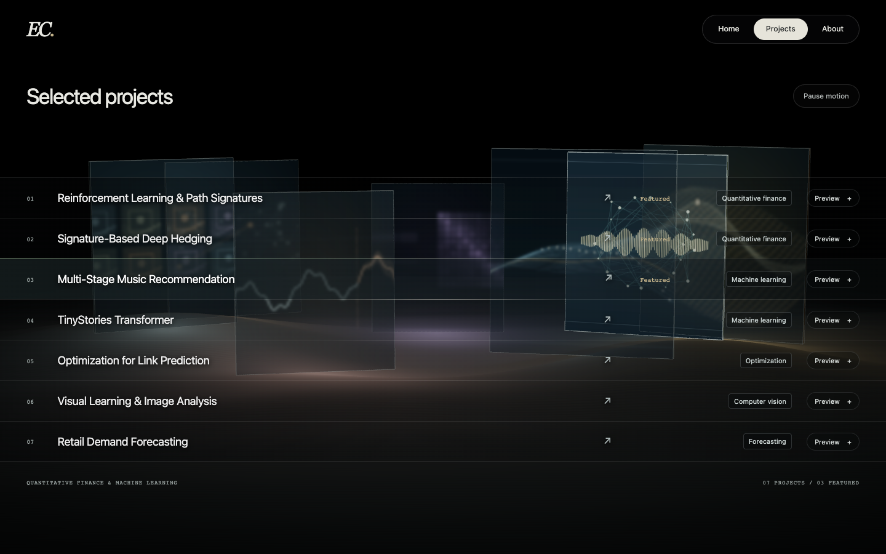

# Smoother orbital gallery

14 October 2026. Optimization following the orbital prototype `b64206b`.

## Rendering changes

- One full-resolution, four-sample HDR target for the scene. Its resolved texture
  stays sharp; there is no reduction of canvas DPR, poster resolution or video resolution.
- A small Gaussian glow replaces the five-level bloom chain. It runs in two
  quarter-width/quarter-height buffers without depth or multisampling.
  Glow, vignette, tone mapping and color conversion share one final screen pass.
- The five frame faces share one draw per panel. The fully transparent hero
  points are excluded from the Works render.
- Section measurements run after scrolling or resizing. Equal DOM attributes,
  media availability and texture assignments are no longer written repeatedly.
  Diagnostic bounds update at 10 Hz while drifting; motion still updates every frame.
- Same 90-second orbit, hover spring, blur treatment, native links, previews,
  motion controls and resource cleanup.

## Before and after

Chrome 155.0.8059.79, Apple M3 / ANGLE Metal, headless, DPR 2 in each layout.
Each run warms up for three seconds and samples six seconds of active orbit with
normal video playback. Other preview animation was paused for both runs.

| Viewport   | Render callbacks / second | p95 frame interval, ms | Draw calls / frame |
| ---------- | ------------------------: | ---------------------: | -----------------: |
| 1440 × 900 |               31.8 → 60.0 |            33.4 → 16.8 |            66 → 26 |
| 768 × 1024 |               54.2 → 60.0 |            33.3 → 16.7 |            66 → 26 |
| 390 × 844  |               60.0 → 60.0 |            16.8 → 16.7 |            53 → 23 |

At 1440 × 900, the median frame interval went from 33.3 to 16.7 ms.
The after sample had **zero intervals above 25 ms** in all three dimensions.
Desktop layout recalculations fell from 192 to zero during the six-second sample;
DOM mutations fell from about 544 to 31 per second.

The benchmark counts only animation callbacks that actually submit WebGL draws,
not an unrelated rAF counter. It also collects asynchronous GPU elapsed queries
when `EXT_disjoint_timer_query_webgl2` is available. Desktop mean GPU elapsed
fell from 55.4 to 20.7 ms; this includes driver scheduling and is not a claim about
exclusive GPU utilization or presented display frames. No synchronous GPU waits
are introduced. Results vary with hardware, browser, power mode and other work.
Physical mobile devices and real Safari/Firefox remain part of milestone 5.

[Before metrics](before.json) · [After metrics](after.json)

The final glow intensity was reduced from 1.9 to 0.7 after timing to keep the
selected illustration crisp. This changes a uniform, not the passes or sampling cost.

## Checks

- `npm run verify`: formatting, Astro/TypeScript, build, 11 routes and 222 references.
- [Orbit regression](orbit.json): all seven focus targets, rapid retargeting,
  keyboard priority, pause with no continuing RAF, resume, previews and four layouts.
- [Retina regression](retina.json): 2880 × 1800 desktop drawing buffer,
  four-sample MSAA, 1536 × 960 source videos, one canvas and 2× no-JS fallback.
- [Interaction regression](interactions.json): 34 scenarios and eight layout checks,
  including browser history, repeated previews/navigation, context loss, offscreen
  pause, reduced motion, Save-Data, video errors and no-JavaScript/WebGL access.
  GPU object counts stayed at four geometries and 14 textures after each group of
  three preview cycles. No browser exceptions; the benchmark and orbit/Retina
  checks also reported no console errors.

## Final preview



[Live in-app focused view](live-preview.png) ·
[Drifting desktop](drifting-1440.png) · [Tablet](drifting-768.png) · [Phone layout](drifting-390.png)

The hover and live captures use the final subtle glow strength. Benchmark captures
were made before that last uniform adjustment.

## Reproduce

```sh
npm run verify
PLAYWRIGHT_MODULE=/path/to/playwright/index.mjs node scripts/profile-scene-browser.mjs
PLAYWRIGHT_MODULE=/path/to/playwright/index.mjs node scripts/check-orbit-browser.mjs
PLAYWRIGHT_MODULE=/path/to/playwright/index.mjs node scripts/check-scene-quality-browser.mjs
PLAYWRIGHT_MODULE=/path/to/playwright/index.mjs node scripts/check-interactions-browser.mjs
```

`PORTFOLIO_BASE_URL` overrides the local server; `PORTFOLIO_SCREENSHOTS` overrides
output. Benchmark results are descriptive rather than hardware-dependent CI gates.

No new dependency or public deployment.
