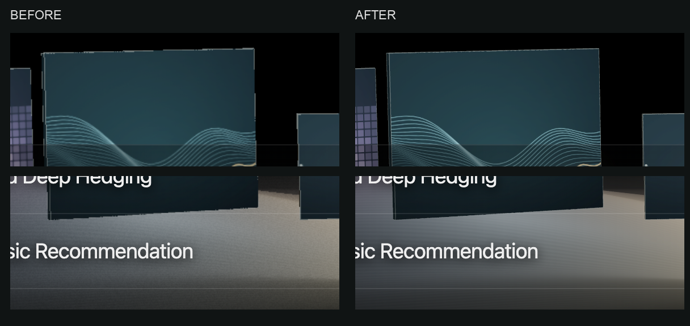

# Works scene — image quality correction

14 October 2026, following the visual layout checkpoint `e2162d0`.

## Diagnosis and correction

The desktop canvas was capped at DPR 1.3 and compact views at DPR 1, including
Retina displays. EffectComposer used non-multisampled offscreen targets, so the
renderer’s default-framebuffer antialiasing did not smooth the final gallery.
World-space grain was sampled above pixel frequency, and video sources were
768 × 480 with hard rasterized curves.

| Item                     | Before            | After                             |
| ------------------------ | ----------------- | --------------------------------- |
| 1440 × 900, DPR 2 canvas | 1872 × 1170       | 2880 × 1800                       |
| 768 × 1024, DPR 2 canvas | 768 × 1024        | 1536 × 2048                       |
| 390 × 844, DPR 3 canvas  | 390 × 844         | 780 × 1688                        |
| Post-processing MSAA     | None              | 4 supported samples on tested GPU |
| Scene SVG raster size    | 960 × 600         | 1920 × 1200                       |
| Video sources            | 768 × 480, CRF 25 | 1536 × 960, CRF 18                |
| Static fallback          | 1× image          | 1× and 2× responsive candidates   |

Videos are drawn at 2304 × 1440 and downsampled with Lanczos before encoding.
The ground’s grain and ripples now fade below pixel size using shader derivatives.
No layout, title, study content or navigation change is part of this correction.

## Visual comparison

Identical crops from 1440 × 900 pages captured at DPR 2, at original physical
pixel scale, previews paused. Panel edges, curves and ground noise can be compared.



[Full Retina gallery](index-retina.png) · [Retina fallback without JavaScript](no-js-retina.png)

## Validation

- `npm run verify`: formatting, Astro/TypeScript, build, 11 routes and 222 internal references.
- `scripts/check-scene-quality-browser.mjs`: actual drawing-buffer dimensions,
  observed WebGL multisample allocations, decoded video dimensions, seven rows,
  one canvas, no horizontal overflow, no browser errors, 2× fallback loaded without JS.
- [Before measurements](before.json), [after measurements](after.json).
- The existing interaction regression passes 34 scenarios and 8 layout checks,
  with no JavaScript errors; [results](interactions.json). GPU object counts remain
  stable after nine preview cycles (5 geometries, 24 textures).
- Local in-app preview refreshed: at 746 × 749 CSS pixels and DPR 2,
  drawing buffer measured 1492 × 1498, previously 746 × 749.

```sh
npm run verify
PLAYWRIGHT_MODULE=/path/to/playwright/index.mjs node scripts/check-scene-quality-browser.mjs
PLAYWRIGHT_MODULE=/path/to/playwright/index.mjs PORTFOLIO_SCREENSHOTS=test-results/quality-interactions node scripts/check-interactions-browser.mjs
```

## Cost and limits

DPR is capped at 2 and the drawing buffer at 8,388,608 pixels to bound GPU cost.
MSAA uses the highest supported half-float sample count up to 4. The existing
video limit (two desktop, one constrained), visibility pauses and idle rendering
remain in place. The three video files total 2,614,632 bytes; all six fallback
WebP variants total approximately 415 kB. No new runtime dependency.

Chrome and the local Mac preview were checked. Physical mobile performance and
real Safari/Firefox remain part of the final responsive/performance milestone.
The existing Vite warning about the Three.js chunk remains.

Reference semantics: [EffectComposer pixel ratio](https://threejs.org/docs/pages/EffectComposer.html#setPixelRatio)
and [render target MSAA](https://threejs.org/docs/pages/RenderTarget.html#samples).
